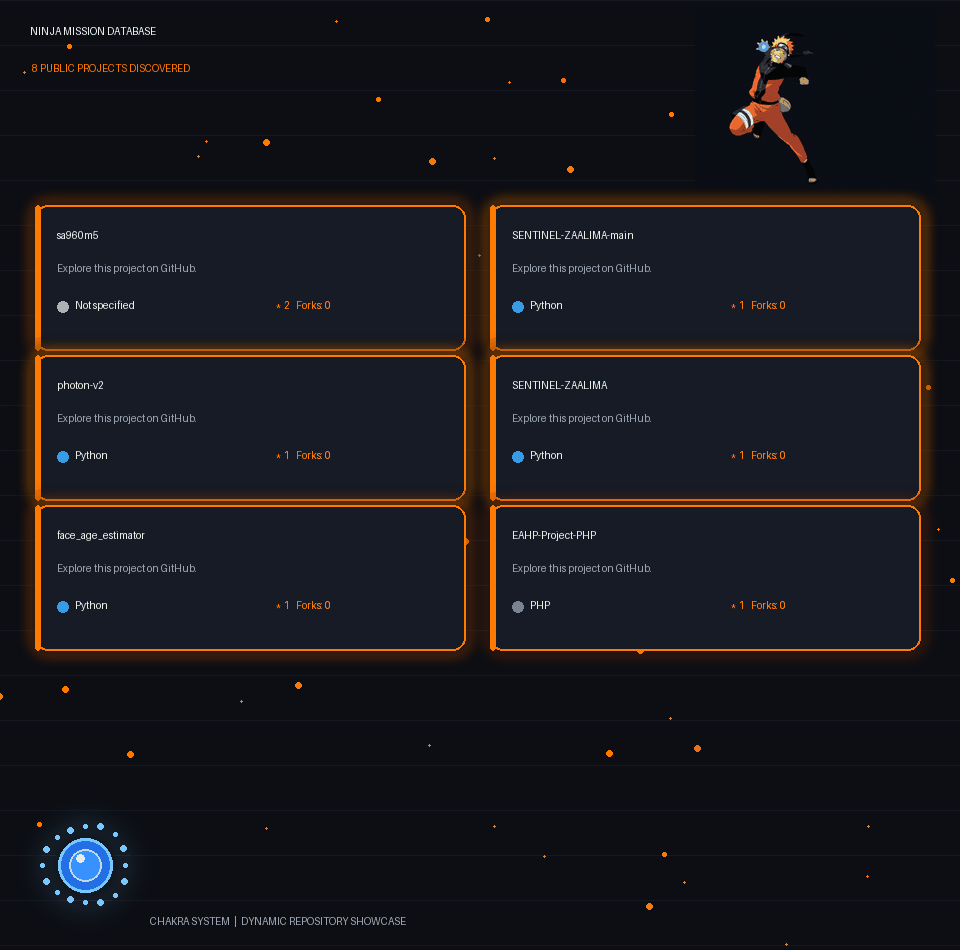

# 🍥 sa960m5's Ninja Profile

### Believe It! — Welcome to my Hidden Leaf Village.

## 🍃 About the Shinobi

- 🥷 GitHub Ninja: **[@sa960m5](https://github.com/sa960m5)**
- ⚡ Exploring development and technology.
- 🔥 Building projects and learning new skills.
- 🌀 Turning ideas into real-world applications.

## 🌀 Ninja Mission Database

## ⚔️ Featured Ninja Missions

| Repository | Language | Stars | Forks |
|---|---|---:|---:|
| [sa960m5](https://github.com/sa960m5/sa960m5) | Not specified | ⭐ 0 | 🍴 0 |
| [naruto-profile](https://github.com/sa960m5/naruto-profile) | Python | ⭐ 0 | 🍴 0 |
| [photon-v2](https://github.com/sa960m5/photon-v2) | Python | ⭐ 0 | 🍴 0 |
| [SENTINEL-ZAALIMA-main](https://github.com/sa960m5/SENTINEL-ZAALIMA-main) | Python | ⭐ 0 | 🍴 0 |
| [face_age_estimator](https://github.com/sa960m5/face_age_estimator) | Python | ⭐ 0 | 🍴 0 |
| [EAHP-Project-PHP](https://github.com/sa960m5/EAHP-Project-PHP) | PHP | ⭐ 0 | 🍴 0 |
| [e_learning_application](https://github.com/sa960m5/e_learning_application) | Dart | ⭐ 1 | 🍴 0 |

## 📊 Shinobi Statistics

## 🐍 Shinobi Contribution Journey

### 🍥 A shinobi never gives up!

<!-- Generated automatically by Naruto Profile Framework -->

